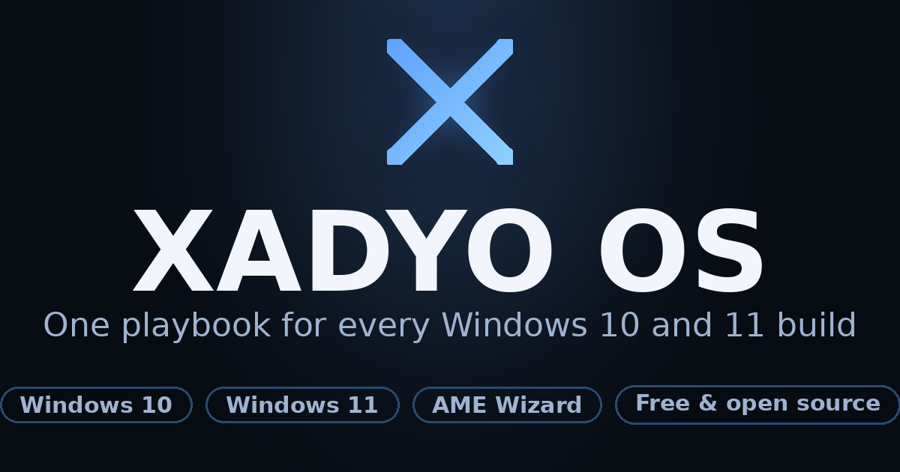

<div align="center">



# X-ADYO OS — Website & Docs

**One playbook for every Windows 10 and 11 build.** This repo is the marketing page and docs site for **[X-ADYO OS](https://github.com/adityagg13/X-ADYO-OS)** — a single AME Wizard playbook covering Windows 10 1809 to Windows 11 26H2.

<p>
  <a href="https://xadyoos.vercel.app"></a>
  <a href="https://xadyoos.vercel.app/docs"></a>
  <a href="https://github.com/adityagg13/xadyoos/actions/workflows/deploy.yml"></a>
  <a href="https://github.com/adityagg13/X-ADYO-OS/releases/latest"></a>
</p>

<p>
  
  
  
  
  
</p>

| | |
| :-- | :-- |
| 🌐 **Live site** | [xadyoos.vercel.app](https://xadyoos.vercel.app) |
| 📖 **Docs** | [xadyoos.vercel.app/docs](https://xadyoos.vercel.app/docs) |
| 🧩 **Playbook repo** | [adityagg13/X-ADYO-OS](https://github.com/adityagg13/X-ADYO-OS) |
| 📥 **Download** | [latest .apbx package](https://github.com/adityagg13/X-ADYO-OS/releases/latest) |

</div>

---

## What the page says

- Hero with a playbook-run window: staged progress, build stats, report generated
- "Built for" strip: AME Wizard, Windows 10/11, PowerShell, Winget, GPL-3.0
- Feature bento: one playbook for every build, three presets, measured report, reversible by design
- How it works: grab the .apbx, pick a preset, apply and read the report
- Inside the pass: Debloat / Privacy / Performance panels with sample data
- Metrics, FAQ and a download CTA with direct downloads (the .apbx and AME Wizard both start downloading right away — no GitHub pages in between)
- A docs page at `/docs`: install guide, presets, modules, troubleshooting and license, matching the site's design
- Footer with on-site doc links plus YouTube / Discord / GitHub profile icons

All copy lives in `src/content.ts`. The mock UI in the hero is `src/components/DashboardMock.tsx`; the tabbed panels are in `src/sections/Showcase.tsx`; the docs page is `src/pages/DocsPage.tsx`.

> The page uses sample data in the mock panels (progress bars, before/after bars) so the layout can be seen without shipping claims. The build counts and run time are real (15 builds, 3 presets, ~12 minutes from `playbook.conf`).

## Stack

| Layer | Choice |
| :-- | :-- |
| UI | React 19 · TypeScript · Tailwind CSS 4 · motion · lucide-react |
| Build | Vite 8 |
| Hosting | Vercel — static site served from `dist` |
| CI | GitHub Actions → Vercel deploy on every push to `main` |

## Run it

```sh
bun install
bun run dev      # http://localhost:5173 (Vite dev server)
bun run build    # dist/ (static site, ready to deploy)
```

`bun run dev` goes through `scripts/dev.mjs`, which runs Vite on the Node runtime in `.tools/` and falls back to `node` on PATH when that is missing, so the server starts the same way on every machine. On a box with no Node on PATH at all, use `bun run dev:local` or `scripts\dev.cmd` — they locate `.tools\node-v*\node.exe` themselves. Extra arguments are forwarded (`scripts\dev.cmd --port 5174`).

## Edit it

- `src/content.ts` holds every string on the page — headlines, features, steps, FAQ, footer, and all links to the playbook repo.
- `src/App.tsx` is the section stack. Delete a line there to remove a section.
- `src/sections/*` are the sections themselves. `Showcase.tsx` and `Features.tsx` keep their own panel content next to the layout.
- `src/styles.css` holds the design tokens (colours, radii, fonts, keyframes). The palette is a deep navy with an electric-blue accent. Everything rounded is a squircle via `corner-shape`; true circles use `.round`. Bordered surfaces use the `depth` utility instead of a border: an inset edge plus a top highlight.
- `index.html` carries the title, description and Open Graph tags.

## Project structure

```
src/
  App.tsx             section stack
  content.ts          all copy on the page
  pages/
    DocsPage.tsx      the /docs page (pathname-routed in main.tsx)
  sections/           Nav, Hero, LogoCloud, Features, Steps, Showcase, Metrics, Faq, Cta, Footer
  components/         DashboardMock (hero window), Aurora, Button, Logo, Reveal, SectionHeading, Socials
  lib/                small helpers
  styles.css          design tokens + utilities
scripts/
  dev.mjs, dev.cmd    dev server launcher
  postbuild.mjs       prunes dot-files, maps and dangling sourceMappingURL comments,
                      and derives docs.html from index.html (serves /docs)
public/               static files copied as-is
```

## Deploy

The site is hosted on **Vercel** (project `xadyoos` → https://xadyoos.vercel.app). `vercel.json` picks the Vite framework, the `bun run build` command and the `dist` output directory. The `/docs` route is served by a `docs.html` derived from `index.html` in postbuild (so Vercel's cleanUrls handles it); unknown paths return 404.

`.github/workflows/deploy.yml` runs the Vercel CLI on every push to `main` (or manually from the **Actions** tab). Add one repository secret once (**Settings → Secrets and variables → Actions → New repository secret**):

| Secret | Where to get it |
| :-- | :-- |
| `VERCEL_TOKEN` | Vercel dashboard → **Account Settings → Tokens → Create** |

---

<div align="center">
  <sub>Marketing page for <a href="https://github.com/adityagg13/X-ADYO-OS">X-ADYO OS</a> · GPL-3.0</sub>
</div>
